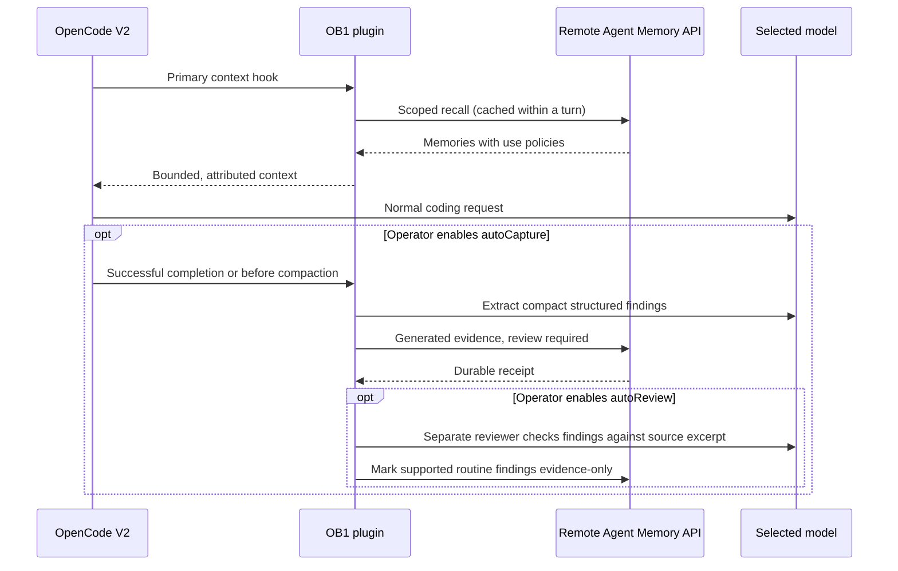

# OpenCode Agent Memory (OB1)



## What It Does

Connects OpenCode's native V2 lifecycle to **Nate B. Jones OB1 Agent Memory**.
Relevant project memories arrive before primary model requests, without asking the
model to discover and call a memory tool. Optional checkpoints preserve compact
findings after successful session completion and before conversation compaction.
An independently selected reviewer can optionally make supported routine findings
eligible for recall as generated evidence, while leaving uncertain items for a human.

OpenCode still manages session history, model context and compaction. OB1 remains
the single shared memory backend. This contribution adds no database schema and
does not install another memory database or MCP server. It calls the existing
remote Supabase Edge Function's runtime-neutral HTTP API, like the other OB1
runtime adapters. Existing remote MCP tools may remain available for explicit
recall, write-back, usage reporting and human review.

Remove redundant "always call recall" prompt rules when enabling the plugin;
otherwise the model may repeat the lookup already supplied by the context hook.

## Prerequisites

- A [working Open Brain](../../docs/01-getting-started.md), the
  [Agent Memory schema](../../schemas/agent-memory/), and the deployed
  [Agent Memory API](../agent-memory-api/).
- OpenCode **2.2.5** (the tested V2 host), Node.js 22+ and npm. V1 hooks are not
  supported. The SDK is pinned for reproducible builds; later V2 versions should
  be tested before deployment.
- The API endpoint and an access key in an environment variable or protected file.
- A configured OpenCode model. No particular model, cloud service or GPU is required.

## Step-by-Step Instructions

1. **Build the plugin.** From your OB1 checkout:

   ```sh
   cd integrations/opencode-agent-memory
   npm ci --ignore-scripts
   npm test
   ```

   **Done when:** tests pass and `dist/index.js` exists. The SDK and TypeScript are
   development dependencies only; the built plugin has no runtime npm dependencies.

2. **Configure access.** Export `OB1_AGENT_MEMORY_KEY` in the environment that starts
   the OpenCode server, or create a protected key file and reference it with
   `keyFile`. Never commit its contents. The key file is read for each request, so
   rotation does not require copying a secret into the configuration.

   Add this plugin entry to your global `~/.config/opencode/opencode.json` (merge
   with existing entries):

   ```json
   {
     "plugins": [
       {
         "package": "/absolute/path/to/OB1/integrations/opencode-agent-memory",
         "options": {
           "endpoint": "https://YOUR_PROJECT_REF.supabase.co/functions/v1/agent-memory-api",
           "workspaceId": "your-workspace",
           "keyFile": "~/.config/ob1/access-key",
           "autoCapture": false
         }
       }
     ]
   }
   ```

   **Done when:** `opencode plugin list` shows `ob1.agent-memory` loaded. If OpenCode
   was already running, start a new session; see its plugin reload documentation
   if an unwatched local build needs a server restart.

3. **Choose project boundaries.** By default, each OpenCode project uses
   `opencode:<OpenCode project ID>` in OB1. Sessions, child agents and other plugin
   locations cannot share a recall cache. Child sessions are excluded entirely.
   For cross-client continuity, put an explicit `projectId` in this plugin's
   options in that project's OpenCode config, using the same ID as your other OB1
   clients. Configure each project entry with its endpoint, workspace and credential
   reference as above. Do not give unrelated projects one global `projectId`.

   **Done when:** the API recall trace shows the intended workspace/project and
   `runtime.name = "opencode"`.

4. **Verify against your instance.** The live smoke check is read-only:

   ```sh
   export OB1_AGENT_MEMORY_ENDPOINT="https://YOUR_PROJECT_REF.supabase.co/functions/v1/agent-memory-api"
   export OB1_AGENT_MEMORY_WORKSPACE_ID="your-workspace"
   export OB1_AGENT_MEMORY_KEY_FILE="$HOME/.config/ob1/access-key"
   npm run smoke:live
   ```

   It uses an isolated `opencode-read-only-smoke` project by default. An empty recall
   is a successful connectivity check; it does not prove useful memories exist.
   `OB1_SMOKE_PROJECT_ID` can select an existing project without changing it.

   **Done when:** output contains `ok: true`, a real `request_id`, and `writes: 0`.

5. **Optionally enable checkpoints.** Set `autoCapture: true` in the desired project
   configuration only after deciding that its findings may be stored in OB1.
   This sends a bounded excerpt of visible user/assistant text to the session's
   selected model for extraction, then sends only validated structured findings
   to OB1. It excludes reasoning blocks, tool outputs and attachments. It adds model
   calls and may add latency before compaction.

   **Done when:** a successful session produces pending-review memories with
   `runtime=opencode`, project/session linkage, and generated provenance. No memory
   is automatically promoted to a trusted instruction. Check the API's inspector
   or your existing OB1 review tools for the receipt, not just a model's claim.

6. **Optionally authorize automatic evidence review.** Configure the reviewer model
   through OpenCode's normal provider authentication, then add these plugin options:

   ```json
   {
     "autoReview": true,
     "reviewModel": { "providerID": "your-provider", "id": "your-reviewer-model" },
     "reviewTimeoutMs": 120000
   }
   ```

   This is a separate consent boundary from capture. The selected reviewer receives
   a bounded visible conversation excerpt and the newly captured findings. A cloud
   reviewer sends that material to its provider and uses that provider's allowance
   or billing. There is no automatic model or API-key fallback in this plugin.
   For ChatGPT subscription access, use OpenCode's supported sign-in integration,
   verify the active credential and model, and follow
   [OpenAI's plan-use guidance](https://learn.chatgpt.com/docs/sign-in-with-chatgpt).

   The reviewer holds sensitive, conflicting, unsupported and consequential claims.
   Only supported routine findings with an exact source quote may receive
   `evidence_only`. Generated provenance is preserved; the adapter never calls
   `confirm`, labels an AI verdict human-confirmed, deletes memories, or edits their
   contents. Existing pending memories are not swept automatically. Approval still
   reflects model judgment, not independent proof of a factual claim.

   **Done when:** the OB1 review history names the automated reviewer, the memory
   has `review_status=evidence_only`, and `can_use_as_instruction` remains false.
   Held findings stay pending for explicit human review.

## Expected Outcome

- Primary requests receive up to three scoped, policy-eligible memories. The
  default recall request asks for 1,500 tokens; the plugin independently enforces
  a **6,000-byte** envelope including labels/JSON. These are distinct limits, not
  a promise that four bytes always equal one token.
- Tool continuations reuse recall for up to five minutes. Changed user requests
  and compaction refresh it. Cache entries are bounded to 128 sessions.
- Memory is identified as evidence or confirmed guidance, subordinate to current
  instructions. Missing policies, wrong scopes and confirmation-required items
  are excluded. Filtered items are reported as ignored; injection is never
  falsely reported as actual model use.
- Title generation, extraction requests and child sessions do not trigger recall.
- With capture enabled, successful checkpoints carry idempotency keys and durable
  receipts. Failed writes do not advance the receipt. Retries of the same excerpt
  do not create new memories. Semantically similar findings from different
  excerpts can still overlap; this adapter is not a consolidation engine.
- Network errors produce a bounded warning and let coding continue. Recall backs
  off for 15 seconds after failure. Normal OpenCode compaction is never replaced.

## Configuration Reference

| Option | Default | Meaning |
| --- | --- | --- |
| `enabled` | `true` | Set false to disable this plugin instance. |
| `endpoint` | `OB1_AGENT_MEMORY_ENDPOINT` | Credential-free Agent Memory API URL. |
| `workspaceId` | `OB1_AGENT_MEMORY_WORKSPACE_ID` | Required OB1 workspace. |
| `projectId` | OpenCode project namespace | Override per project for shared client continuity. |
| `keyEnv` | `OB1_AGENT_MEMORY_KEY` | Name of the environment variable holding the key. |
| `keyFile` | `OB1_AGENT_MEMORY_KEY_FILE` | Optional protected file; environment key takes precedence. |
| `autoCapture` | `false` | Opt into generated checkpoint write-back. |
| `maxItems` | `3` | Recall item limit, 1–10. |
| `maxTokens` | `1500` | Requested backend token budget, 256–4000. |
| `maxContextBytes` | `6000` | Hard injected context byte limit, 512–16000. |
| `timeoutMs` | `5000` | Each HTTP request deadline, 100–30000 ms. |
| `captureTimeoutMs` | `30000` | Extraction/write deadline, 100–120000 ms. |
| `autoReview` | `false` | Authorize review of this adapter's captured findings as evidence only. |
| `reviewModel` | none | Required explicit `{providerID, id, variant?}` when review is enabled. |
| `reviewTimeoutMs` | `120000` | Separate review deadline, 100–300000 ms. |
| `allowInsecureHttp` | `false` | Explicit exception for a trusted LAN; loopback HTTP is allowed. |

Setting session metadata `ob1Memory` to `false` excludes that session from both
recall and capture. Existing stored memories are not deleted by disabling capture.
Configuration is the consent boundary for automatic writes. Redaction checks are
defense in depth, not a comprehensive data-loss-prevention system; do not enable
capture for sensitive work whose findings must not be retained.

## Tests

```sh
npm test
npm run smoke:native
```

`smoke:native` uses the installed `opencode` binary (override `OPENCODE_BIN` if
needed), a temporary project, and local fake model/OB1 endpoints. It exercises
native plugin loading, context injection, completion checkpoint delivery and compaction without
external writes or paid model calls. It creates and removes a synthetic OpenCode session.
It also verifies review delivery and the evidence-only action through the native host.
`smoke:live` separately checks the real remote OB1 contract with no write-back.
See [DESIGN.md](DESIGN.md) for the implementation boundaries.

## Troubleshooting

### Plugin is absent

Run `npm run build`, check that the configured package path is the contribution
directory (not a single file), and run `opencode plugin list`. This plugin requires
V2; V1's `experimental.chat.*` hooks are a different API.

### Recall is empty or absent

Check the credential environment of the **server**, the project ID, and the OB1
review state. Unconfirmed memories intentionally do not qualify. Recall can also
be skipped for child sessions, session opt-outs, or credential-like input. An API
outage never blocks normal work. Use recall traces to distinguish empty results
from a request that was never made.

### Checkpoints do not appear

Capture is off by default. After enabling it, verify the session succeeded and the
selected model can emit a small JSON object within `captureTimeoutMs`. Invalid
JSON, code blocks, suspicious secrets, empty findings and backend policy rejection
do not create a memory. Long reasoning modes may exceed the deadline; inspect
the warning rather than assuming a write occurred. Completion checkpoints run in
the background and need the OpenCode server to remain alive. A standalone CLI
process that exits immediately, a crash or a forced shutdown can interrupt them;
use a persistent server for reliable completion-event handling.

### Findings remain pending after automatic review

The reviewer may have held the finding, lacked an exact supporting quote, failed to
return valid JSON, exceeded its deadline, or lost provider access. No fallback model
is selected. Errors leave the memory pending and keep the capture receipt. The same
excerpt can retry failed review without repeating write-back; after the session moves
on, unresolved findings may require manual review. Human edits and review state are
rechecked before mutation. The existing API has no conditional-update parameter, so
avoid reviewing the same item manually while its automatic review is in flight.

### Self-hosted LAN endpoint is refused

Prefer HTTPS. For a deliberately trusted LAN, set `allowInsecureHttp: true` (and
`OB1_SMOKE_ALLOW_HTTP=1` for the live smoke command). Redirects are always refused
so credentials cannot follow a redirected request to another service.

## Next Steps

Review the [MCP Tool Audit & Optimization Guide](../../docs/05-tool-audit.md) before
adding explicit memory tools alongside the automatic hooks, and the
[Agent Memory API](../agent-memory-api/) for provenance and review operations.
Open Brain was created by [Nate B. Jones](https://natebjones.com); find more practical
systems and context workflows in [Nate's newsletter](https://substack.com/@natesnewsletter).
